# EcoMarket

Tienda en línea de productos ecológicos, reutilizables y sustentables.

**Sitio publicado:** https://ecomarket-sebastiancalderon.netlify.app

## Descripción del proyecto

EcoMarket es una tienda ficticia de Bucaramanga que vende productos para reducir el plástico en el día a día. Los productos están organizados en cuatro categorías: hogar, moda, cuidado personal y alimentos.

El sitio tiene cuatro vistas:

- **Inicio:** cabecera con logo, menú y accesos a búsqueda y carrito. Portada con el mensaje "Compra responsable, vive sostenible" y el botón "Explorar productos". Grid de 6 productos destacados y pie de página con contacto, enlaces legales y redes sociales.
- **Productos:** catálogo de 20 productos en CSS Grid. Tiene filtros laterales que acompañan el scroll (categorías, rango de precio y disponibilidad), buscador, etiqueta de stock o agotado, botón de favoritos y paginación.
- **Sobre nosotros:** historia de la tienda con imagen y texto, principios ecológicos con íconos y un carrusel de testimonios de clientes.
- **Contacto:** formulario con nombre, email y mensaje con validación visual, mapa de la sede y redes sociales.

## Instrucciones de visualización

**En línea:** abrir https://ecomarket-sebastiancalderon.netlify.app

**En local:**

1. Clonar el repositorio:
   ```
   git clone https://github.com/c4lde/EcoMarket_SebastianCalderon.git
   ```
2. Abrir `index.html` en el navegador. También se puede abrir con la extensión Live Server de VS Code.

No hace falta instalar nada, porque el proyecto no tiene dependencias.

## Tecnologías utilizadas

- **HTML5 semántico:** `header`, `nav`, `main`, `section`, `article`, `aside`, `figure`, `form` y `footer`.
- **CSS3:** variables en `:root`, Flexbox, Grid, media queries, transiciones y `@keyframes`.
- **Google Fonts:** Playfair Display para los títulos e Inter para el texto.
- **Git y GitHub**, trabajando con GitFlow.
- **Netlify** para el despliegue.

## Estructura de archivos

```
EcoMarket/
├── css/
│   ├── main.css          # Reset, variables, tipografía
│   ├── layout.css        # Header, footer, grids de cada página
│   ├── components.css    # Tarjetas, botones, inputs, filtros
│   └── animations.css    # Transiciones, hover y keyframes
├── img/
│   ├── products/         # Fotos de los 20 productos
│   ├── icons/            # Íconos en SVG
│   ├── hero/             # Imagen de portada y mapa
│   ├── testimonios/      # Fotos de los clientes
│   ├── mockups/          # Mockups de cada vista
│   └── capturas/         # Capturas del sitio publicado
├── views/
│   ├── productos.html
│   ├── sobre-nosotros.html
│   └── contacto.html
├── index.html            # Inicio
└── README.md
```

## Diseño responsive

Se trabajó con enfoque **Mobile First**: los estilos base son los del celular y las media queries con `min-width` van agregando cambios para pantallas más grandes.

| Breakpoint | Qué cambia |
|---|---|
| Base (celular) | Todo en una columna. El menú va en una segunda fila de la cabecera y los filtros quedan arriba de los productos. |
| 600px (tablet) | Productos destacados, catálogo y principios en 2 columnas, filtros en 3 columnas y pie de página en 2. |
| 1024px (escritorio) | La cabecera queda en una sola fila, los filtros pasan a una barra lateral que acompaña el scroll con `position: sticky` y el catálogo pasa a 3 columnas. La historia muestra imagen y texto lado a lado, los principios van en 4 columnas y en contacto el formulario queda al lado de la información. |
| 1280px | El catálogo pasa a 4 columnas. |

## Interactividad con CSS

Como el proyecto no usa JavaScript, toda la interacción se resolvió con CSS:

- **Tarjetas:** se elevan al pasar el mouse con `transform: translateY()` y `transition`.
- **Favoritos:** el corazón de cada producto es un enlace a su propia tarjeta (`#p1`, `#p2`...). Con `:target` se pinta de rojo.
- **Productos agotados:** la foto pasa a escala de grises y el botón "Agregar" queda desactivado.
- **Carrusel de testimonios:** se desplaza solo con `@keyframes` y se pausa con `animation-play-state: paused` al pasar el mouse.
- **Formulario:** los campos se marcan en rojo si están vacíos o mal escritos, y en verde si son correctos. Se usan `:valid`, `:invalid` y `:placeholder-shown`.
- **Redes sociales:** los íconos crecen con `transform: scale()` al pasar el mouse.
- **Paginación:** es visual, como pide el enunciado. Los 20 productos están en la misma página.

## Paleta de colores

| Color | Uso |
|---|---|
| `#2ecc71` | Color principal: botones, etiquetas y acentos |
| `#27ae60` | Hover de botones y enlace activo del menú |
| `#f5f5dc` | Fondo del pie de página |

## Mockups

| Vista | Computador | Celular |
|---|---|---|
| Inicio | 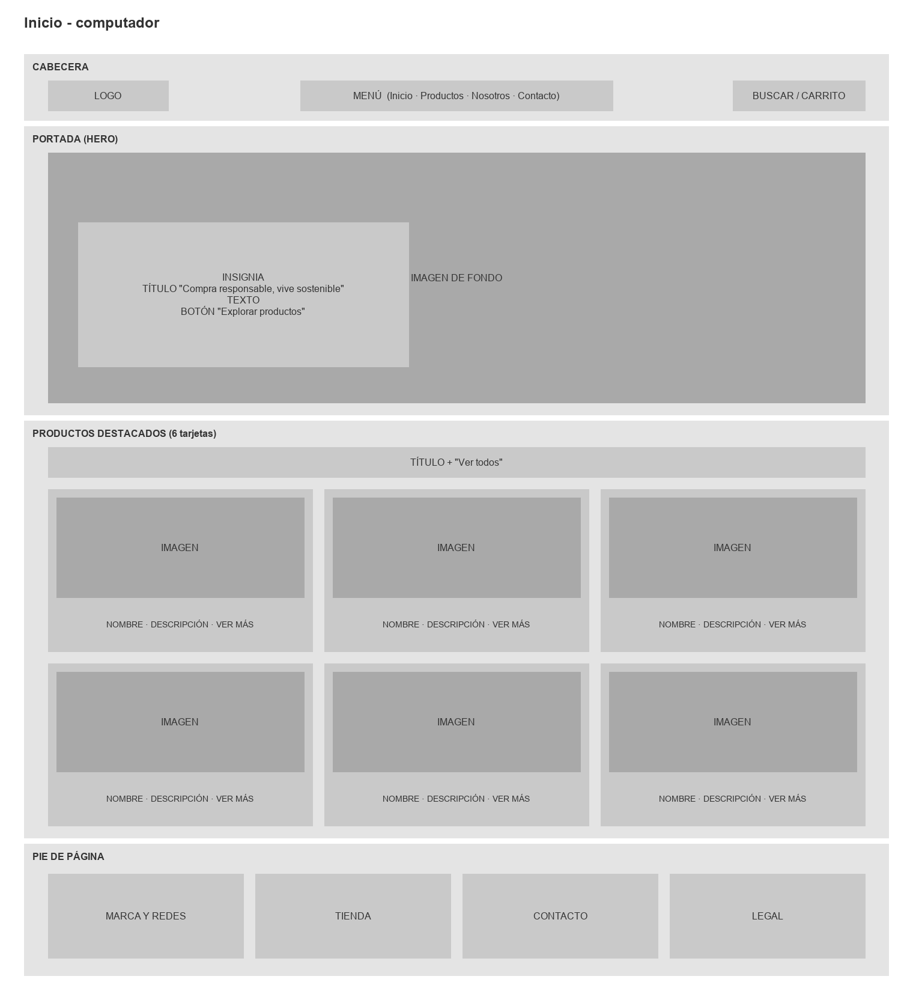 | 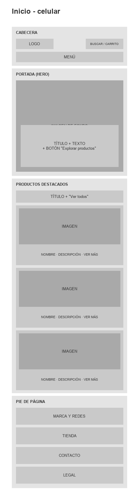 |
| Productos | 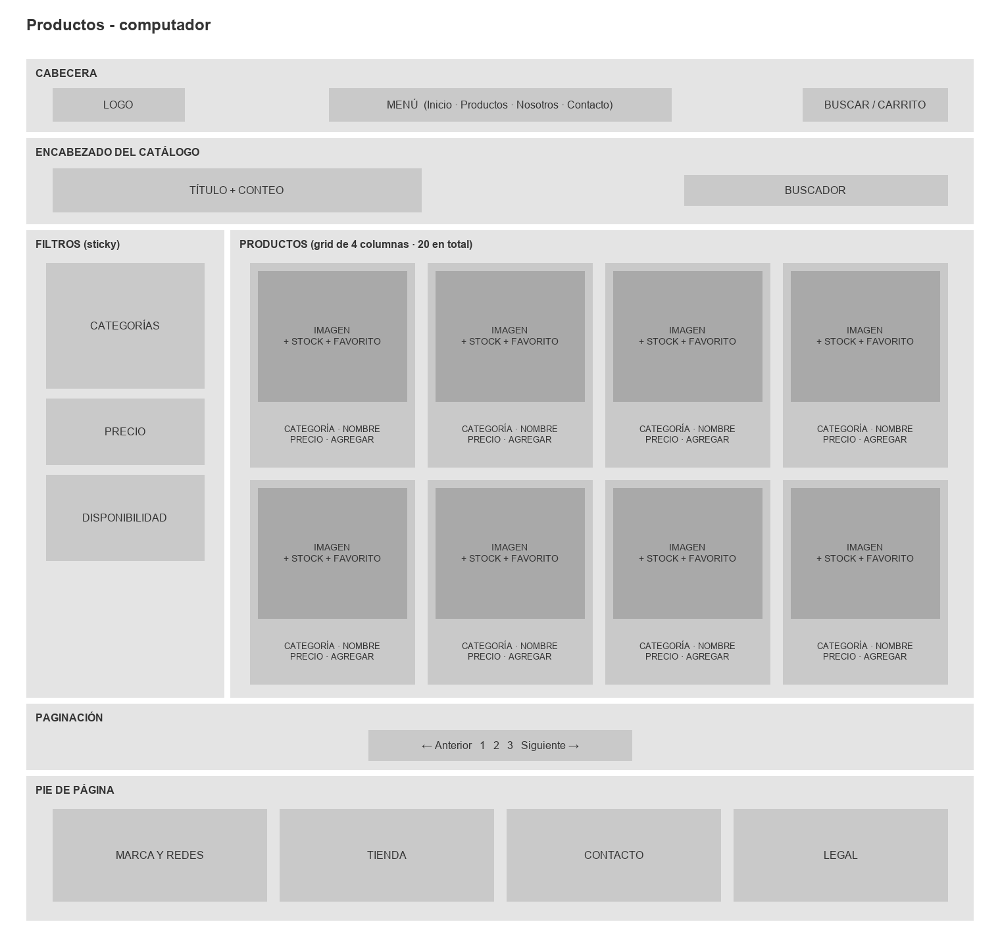 | 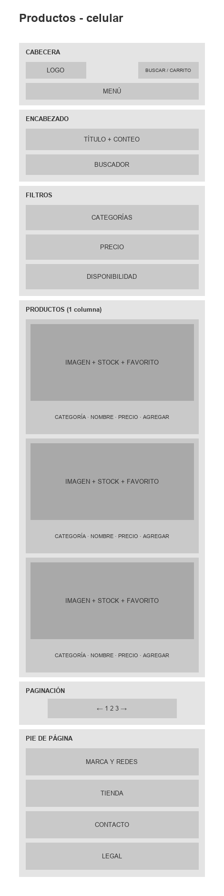 |
| Sobre nosotros | 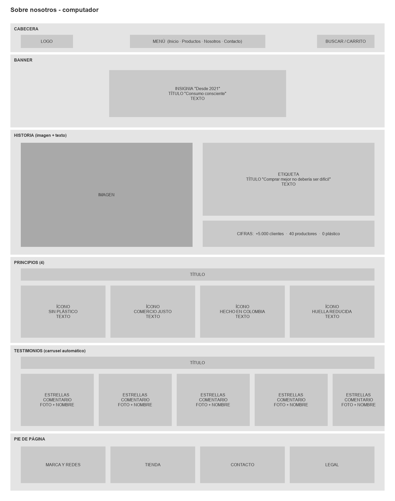 | 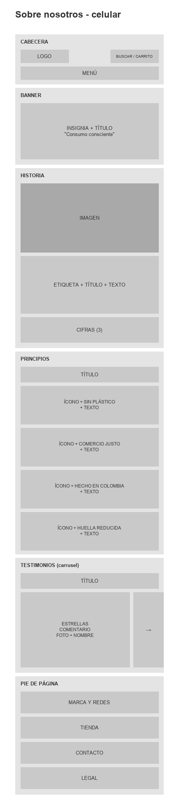 |
| Contacto | 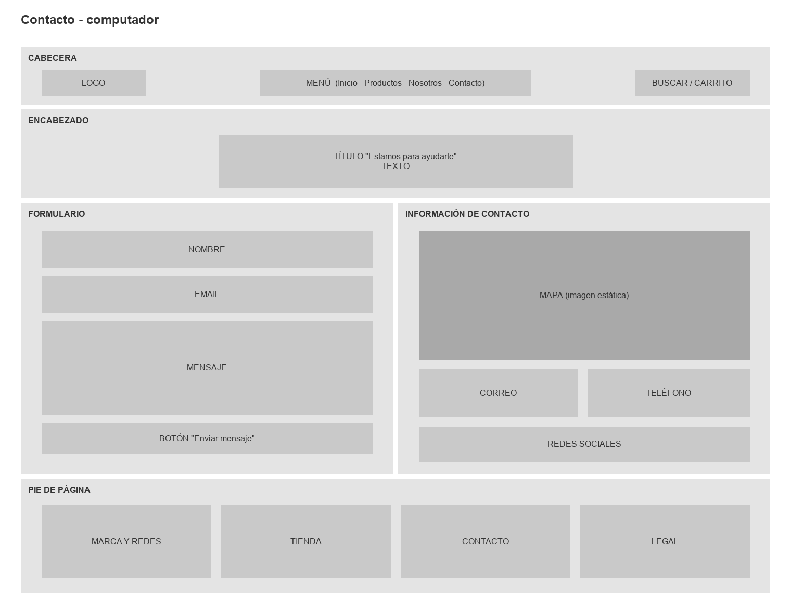 | 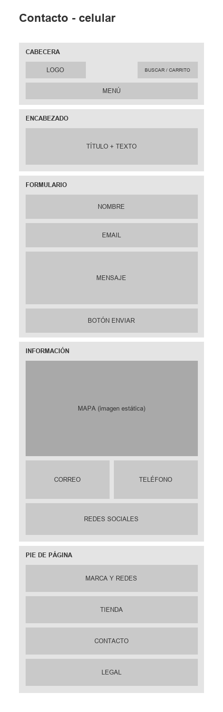 |

## Capturas de pantalla

| Vista | Computador | Celular |
|---|---|---|
| Inicio | 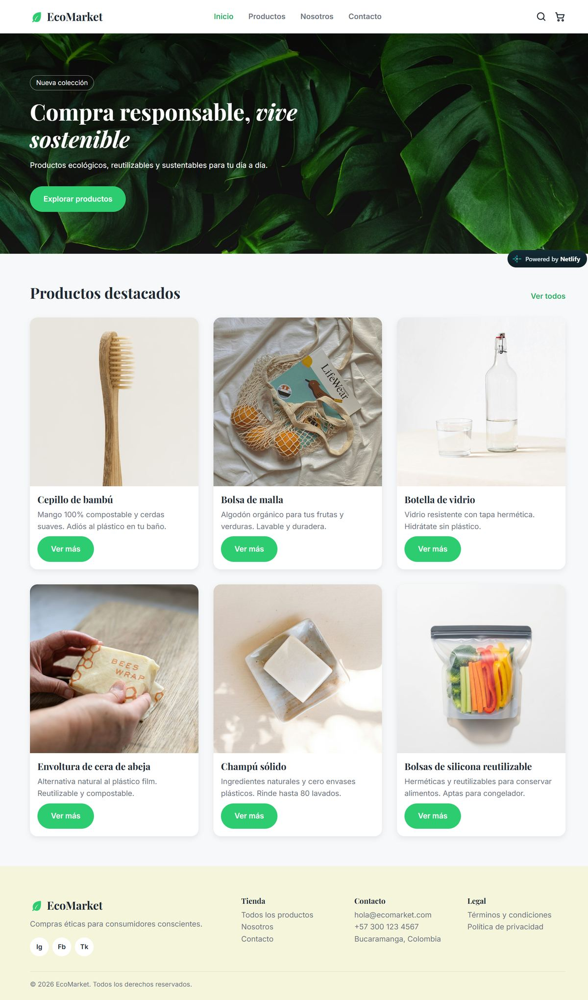 | 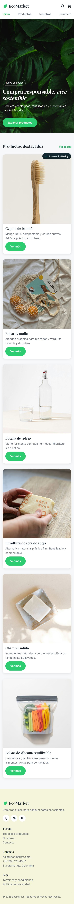 |
| Productos | 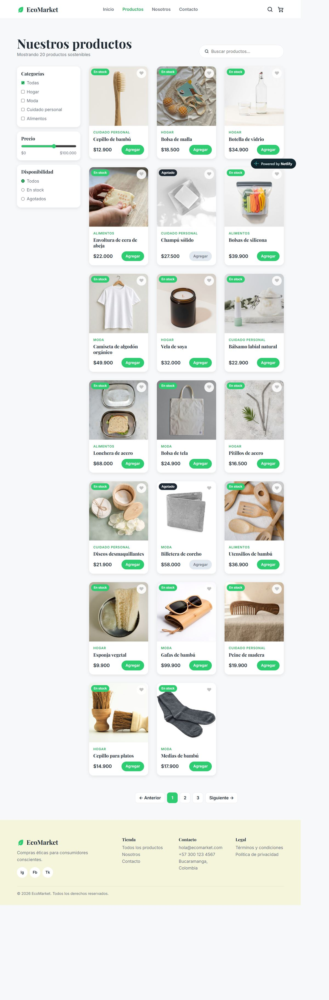 |  |
| Sobre nosotros | 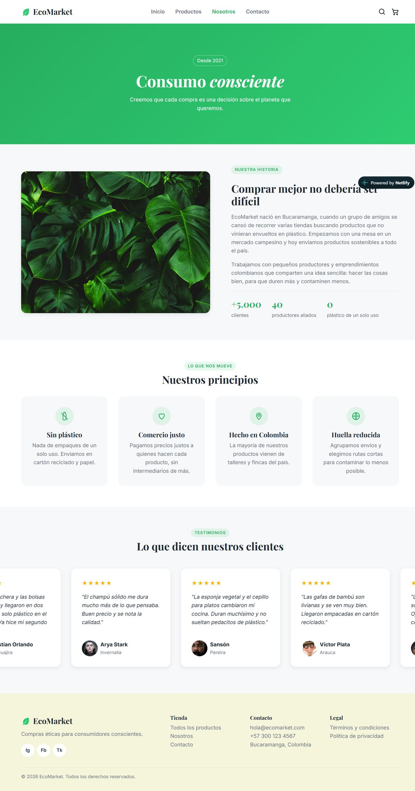 | 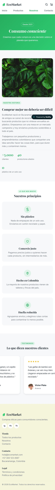 |
| Contacto | 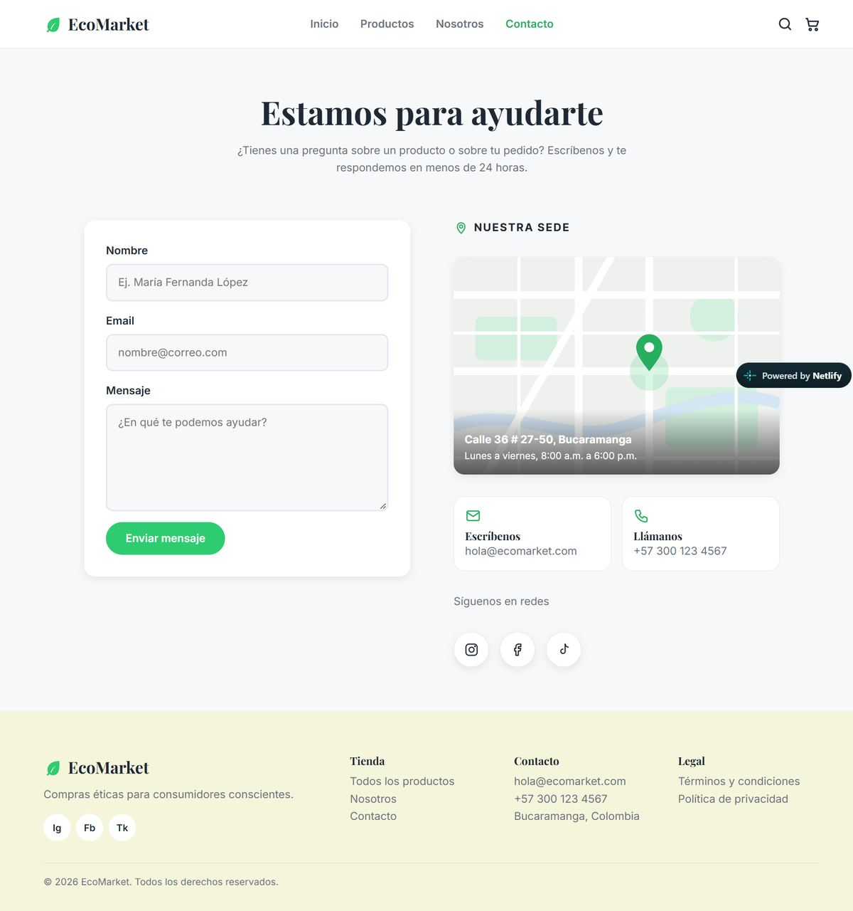 | 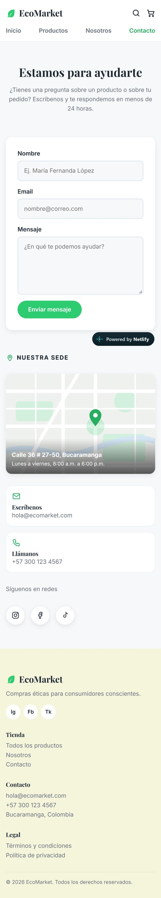 |

## Flujo de trabajo con Git

Se usó GitFlow con estas ramas:

- `main`: versión final, la que se publica en Netlify.
- `develop`: integración de cada parte terminada.
- `feature/base-styles`, `feature/home`, `feature/catalogo`, `feature/sobre-nosotros` y `feature/contact-form`: una rama por cada parte del sitio.

Los commits siguen el formato de Conventional Commits (`feat:`, `fix:`, `perf:`, `docs:`, `chore:`).

## Créditos

- Fotos de productos tomadas de Unsplash, Pexels y Freepik.
- Íconos dibujados en SVG para el proyecto.

## Autor

Sebastián Calderón, Campuslands.
